# RetinaScan MATLAB — Architectural Build Plan

**Problem Statement:** SIH 26038 (MathWorks) — Explainable AI for Diabetic Retinopathy Screening in Rural India  
**Target Environment:** MATLAB R2024a on Windows 11  
**Target Folder:** `D:\RetinaScan_MATLAB_SIH26038`

---

## 1. Prioritization & Engineering Objectives

The build follows the strict scoring hierarchy established by the MathWorks SIH 26038 problem statement:

### P0 — Core Scoring Requirements (Must Work & Be Traceable)
1. **5-Class DR Grading (ICDR Levels 0–4):**
   - Held-out evaluation achieving **Referable DR (Level 2+) Sensitivity > 90% and Specificity > 85%**.
   - No fabricated numbers; verified on real test splits.
2. **Explainability & 30-Second Review:**
   - Real Grad-CAM from actual classification network activations.
   - Lesion evidence matching ICDR criteria.
   - Calibrated confidence via temperature scaling (ECE and reliability diagram).
   - Structured clinical screening report exportable in PDF/HTML with mandatory prototype disclaimer.
3. **SimEvents / Simulink Resource Allocation Model:**
   - Discrete-event simulation scaling to **100,000+ patients/year** across a rural district.
   - Genuine parameter sweep optimization balancing clinician queue wait times, processing nodes, and network bandwidth.
   - Mathematical conservation check: $\text{Arrived} = \text{Completed} + \text{Rejected} + \text{Failed} + \text{In-System}$.
4. **Validation & Ablation Study:**
   - Cross-dataset benchmark comparison against published literature.
   - Ablation comparing: (a) classical features only, (b) CNN only, (c) CNN + quality gate, (d) CNN + quality gate + lesion evidence.

### P1 — Required Pipeline Stages
1. **Image Quality Assessment & Recapture Feedback:** Focus sharpness, illumination entropy, FOV coverage; strict fail-closed gate.
2. **Adaptive Enhancement:** Green-channel / luminance CLAHE with histogram analysis.
3. **Retinal Structure Localization:** Optic disc and fovea localization validated on IDRiD.
4. **Retinal Vessel Segmentation:** Matched filtering validated on DRIVE benchmark.
5. **Lesion Candidate Detection:** Microaneurysms, hard/soft exudates, dot/blot vs. flame hemorrhages, and neovascularization flag.

### P2 — Application Polish
1. Programmatic MATLAB `uifigure` app (`app/RetinaScanApp.m`).
2. India-specific patient registration workflow.
3. Dual-eye synchronized viewer.
4. Usability audit verifying < 30s clinician review time.

---

## 2. Multi-Milestone Execution Roadmap

```mermaid
graph TD
    M1[Milestone 1: Audit & Environment Gate] -->|Approved| M2[Milestone 2: Data, Quality & Structures]
    M2 --> M3[Milestone 3: Model Verification & Calibration Gate]
    M3 -->|Approved| M4[Milestone 4: Explainability & Reporting]
    M4 --> M5[Milestone 5: SimEvents District Simulation]
    M5 --> M6[Milestone 6: Programmatic MATLAB App]
    M6 --> M7[Milestone 7: Smoke Tests & Final Status]
```

### Milestone 1: Audit (Current — [GATE])
- **Deliverables:** `scripts/audit_environment.m`, `outputs/audit/environment_audit_report.txt`, `DEPENDENCIES.md`, `docs/REPOSITORY_AUDIT.md`, `docs/SOURCE_MAPPING.md`, `docs/DATASET_MANIFEST.md`, `docs/MODEL_MANIFEST.md`, `docs/BUILD_PLAN.md`, `VALIDATION_STATUS.md`.
- **Gate Stop:** Report findings, missing toolboxes (Deep Learning & SimEvents), missing datasets (APTOS & Messidor-2), and await user approval before proceeding.

### Milestone 2: Data Manifests, Splits, Quality Gate & Retinal Structures
- Set up directory structure: `src/data/`, `src/preprocessing/`, `src/structures/`, `src/segmentation/`, `src/lesions/`, `tests/`.
- Implement `assess_image_quality.m` with strict fail-closed logic and automated recapture feedback.
- Implement `enhance_retinal_image.m` with luminance CLAHE and histogram verification.
- Implement `detect_optic_disc.m` and `localize_fovea.m`; run unit tests on IDRiD sample images.
- Implement `segment_vessels.m` and evaluate on DRIVE dataset.
- Implement lesion detection candidate modules.

### Milestone 3: Model Compatibility Check, Calibration & Evaluation ([GATE])
- Address Deep Learning Toolbox availability or execute approved execution path.
- Load `retina_model.onnx` or train native MATLAB network.
- Execute inference on IDRiD disease grading test split (103 images).
- Compute confusion matrix, Quadratic Weighted Kappa (QWK), Sensitivity, Specificity with 95% bootstrap CI.
- Fit temperature scaling parameter $T$ on validation set; calculate ECE before and after calibration.
- Execute 4-stage ablation study on identical splits.

### Milestone 4: Explainability, Lesion Overlays & 30-Second Review
- Compute genuine Grad-CAM from actual convolutional feature maps.
- Render combined composite overlay (Grad-CAM heatmap + vessel mask + OD/fovea markers + lesion bounding boxes).
- Formulate plain-language diagnostic rationale tied to ICDR criteria.
- Build clinical screening report generator (HTML/PDF) with English, Tamil, and Hindi referral summaries.

### Milestone 5: SimEvents / Simulink Rural District Simulation
- Build genuine discrete-event simulation model (`src/simulation/`) modeling:
  - Rural clinic patient arrivals (Poisson process, 100k+ patients/year across 25 clinics).
  - Image quality triage and recapture loop.
  - Telemedicine network transmission queues across 2G/3G/4G/offline links.
  - Central ophthalmologist review queue.
- Execute parameter optimization sweep finding minimum clinicians and nodes meeting 95th-percentile turnaround < 4 hours.
- Verify mathematical conservation rule across all seeds.

### Milestone 6: Standalone Programmatic App (`RetinaScanApp.m`)
- Build class-based `uifigure` app in `app/RetinaScanApp.m`.
- Follow the visual workflow of the 6 UI references:
  1. Patient Registration (India-adapted fields: Name, Age, Sex, District, Duration, Consent).
  2. Dual-Eye Capture & Import.
  3. Quality & Enhancement Inspection.
  4. Diagnostic Analysis (ICDR Grade, Calibrated Confidence, Grad-CAM, Lesion counts).
  5. Clinician Review (One-click Confirm, Override, Refer).
  6. Simulation Dashboard.
- Ensure app starts gracefully even if models or toolboxes are missing.

### Milestone 7: Testing, Usability Verification & Final Report
- Comprehensive test suite in `tests/`: invalid images, grayscale, blank, overexposed, corruption handling, patient database persistence.
- Usability measurement: verify clinician decision workflow time < 30 seconds.
- Final clean-session run and status report update in `VALIDATION_STATUS.md`.
