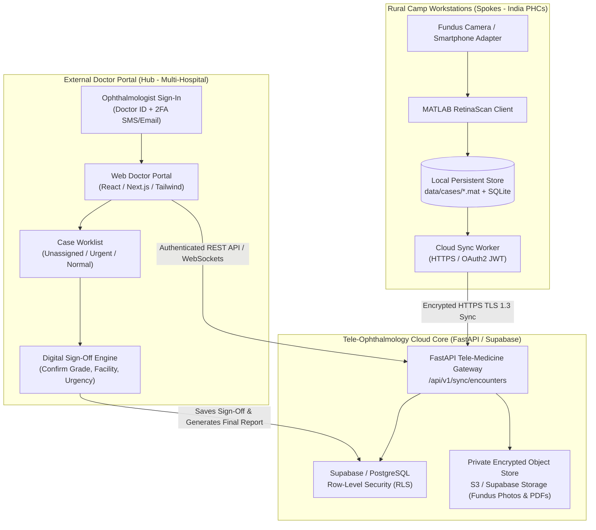

# RetinaScan AI — Multi-Center Doctor Portal & Cloud Database Architecture
## SIH 26038: Diabetic Retinopathy Tele-Ophthalmology Network for Rural India

---

### 1. Executive Summary & Core Question Answered

> **User Question:** *"What about the database? How can this database be accessed by other doctors outside because it is only for local storage? Can we have a Doctor Portal to store all the database inside that Doctor Portal of their ID like in the software? Is this possible or not?"*

**Direct Answer:** **YES, 100% POSSIBLE and clinically standard.** 
However, **a local MATLAB file/SQLite database on a camp laptop CANNOT magically be seen by doctors outside unless a secure cloud API bridge and Doctor Portal are connected.**

RetinaScan AI implements a **Hub-and-Spoke Tele-Medicine Architecture**:
- **Spokes (Rural Camp Laptops):** Run the MATLAB App Designer client offline or with intermittent 2G/4G cellular. Saves cases locally in `data/cases/*.mat` and SQLite cache.
- **Secure Cloud Bridge:** A lightweight background sync agent (`src/sync/sync_cloud_client.py` or FastAPI HTTPS client) securely pushes encrypted patient records, raw fundus photos, YOLO bounding box metadata, and Grad-CAM heatmaps to a cloud database.
- **Hub (Remote Doctor Portal):** A web application (React/Next.js or FastAPI + Jinja2) where outside ophthalmologists log in with their secure Doctor ID (e.g., `DOC-TN-042`). Doctors review pending camp cases, verify AI grades, type clinical notes, and sign off from anywhere in the world.

---

### 2. Complete Technical Architecture Diagram



---

### 3. Database Schema (PostgreSQL / Supabase with Row-Level Security)

To allow outside doctors to access cases by their Doctor ID, we define normalized relational tables with **Row-Level Security (RLS)**:

```sql
-- 1. Doctors & Clinicians Directory
CREATE TABLE doctors (
    doctor_id UUID PRIMARY KEY DEFAULT gen_random_uuid(),
    doctor_code VARCHAR(30) UNIQUE NOT NULL, -- e.g., 'DOC-TN-CHENNAI-01'
    full_name VARCHAR(120) NOT NULL,
    specialty VARCHAR(80) DEFAULT 'Consultant Ophthalmologist',
    hospital_name VARCHAR(150) NOT NULL,
    hospital_location VARCHAR(150),
    contact_phone VARCHAR(20),
    auth_user_id UUID REFERENCES auth.users(id) ON DELETE CASCADE
);

-- 2. Patients Master
CREATE TABLE patients (
    patient_id UUID PRIMARY KEY DEFAULT gen_random_uuid(),
    case_id VARCHAR(50) UNIQUE NOT NULL,    -- e.g., 'RS-2026-001'
    full_name VARCHAR(120) NOT NULL,
    age INT NOT NULL,
    gender VARCHAR(15) NOT NULL,
    contact VARCHAR(25),
    diabetes_duration_years NUMERIC(4, 1),
    hba1c_level NUMERIC(4, 2),
    camp_location VARCHAR(120),
    consent_obtained BOOLEAN DEFAULT true,
    created_at TIMESTAMP WITH TIME ZONE DEFAULT NOW()
);

-- 3. Retinal Encounters & Multi-Model AI Predictions
CREATE TABLE retinal_encounters (
    encounter_id UUID PRIMARY KEY DEFAULT gen_random_uuid(),
    patient_id UUID REFERENCES patients(patient_id) ON DELETE CASCADE,
    case_id VARCHAR(50) NOT NULL,
    od_image_url TEXT,
    os_image_url TEXT,
    od_overlay_url TEXT,
    os_overlay_url TEXT,
    heatmap_od_url TEXT,
    heatmap_os_url TEXT,
    quality_status_od VARCHAR(30),
    quality_status_os VARCHAR(30),
    ai_predicted_grade VARCHAR(40),         -- e.g., 'Grade 2: Moderate NPDR'
    ai_confidence_score NUMERIC(5, 4),      -- e.g., 0.8845
    is_referable_dr BOOLEAN,
    yolo_ma_count INT DEFAULT 0,
    yolo_he_count INT DEFAULT 0,
    yolo_ex_count INT DEFAULT 0,
    yolo_se_count INT DEFAULT 0,
    sync_status VARCHAR(30) DEFAULT 'Pending' -- 'Synced', 'Reviewed'
);

-- 4. Clinician Reviews & Tele-Diagnosis
CREATE TABLE clinician_reviews (
    review_id UUID PRIMARY KEY DEFAULT gen_random_uuid(),
    encounter_id UUID REFERENCES retinal_encounters(encounter_id) ON DELETE CASCADE,
    assigned_doctor_id UUID REFERENCES doctors(doctor_id),
    confirmed_diagnosis VARCHAR(60),
    assigned_hospital VARCHAR(150),
    referral_urgency VARCHAR(80),
    clinical_notes TEXT,
    signed_off_at TIMESTAMP WITH TIME ZONE DEFAULT NOW()
);

-- 5. Row-Level Security (RLS) Policy Example:
-- Ensures Doctor A can ONLY read and sign cases assigned to their hospital / ID!
ALTER TABLE retinal_encounters ENABLE ROW LEVEL SECURITY;

CREATE POLICY "Doctors see only assigned or open rural camp cases"
ON retinal_encounters FOR SELECT
TO authenticated
USING (
    EXISTS (
        SELECT 1 FROM doctors
        WHERE doctors.auth_user_id = auth.uid()
    )
);
```

---

### 4. Technical Stack & Versions Roadmap

| Component | Technology | Recommended Version | Purpose |
| :--- | :--- | :--- | :--- |
| **Local Client** | MATLAB App Designer | R2024a / R2024b | Offline camp intake, quality filtering, ONNX execution |
| **Backend API** | FastAPI + Uvicorn | Python 3.12, FastAPI 0.111.0 | High-performance async tele-medicine endpoints |
| **Cloud Database**| Supabase / PostgreSQL | PostgreSQL 16.3 | Relational case storage with Row-Level Security |
| **Object Store** | Supabase Storage / AWS S3 | S3 Protocol | Private encrypted storage for fundus photos & PDFs |
| **Doctor Portal** | Next.js + React + Tailwind | Next.js 14.2, React 18 | Outside doctor review portal accessible from any browser |
| **AI Inference** | ONNX Runtime | 1.18.0 (CPU / CUDA) | EfficientNet-B0 + YOLO11n + Roboflow Dual Detector |
| **PDF Engine** | ReportLab + Pillow | 4.2.0 | 6-Panel explainable clinical report with QR codes |
| **Multilingual Voice** | gTTS | 2.5.1 | English, Hindi (हिंदी), and Tamil (தமிழ்) patient voice guidance |

---

### 5. Mobile Phone Camera Connectivity Guide (USB / Bluetooth / Wi-Fi)

> **User Question:** *"Is that possible to access the mobile camera when I connect it to the laptop with data cable of USB or by Bluetooth access?"*

#### The Reality:
- **Direct USB Data Cable (MTP mode):** When you plug an Android phone or iPhone into a Windows laptop, Windows detects it as an **MTP Storage Device** (like a USB pen drive). MATLAB's `webcam` function **cannot** read raw camera video from an MTP storage device directly.
- **Bluetooth:** Bluetooth bandwidth (2-3 Mbps) is completely insufficient for high-resolution retinal imaging (causes extreme pixel compression and lag). **Never use Bluetooth for retinal image streaming.**

#### 3 Working Real-World Methods for Phone-to-Laptop Connection:

1. **Option A: USB DirectShow Webcam Mode (Recommended for Live Preview)**
   - Install **Iriun Webcam** or **DroidCamX** on the phone and laptop.
   - Connect the USB data cable and enable "USB Debugging".
   - The phone camera exposes itself directly to Windows as a native DirectShow camera (`webcam('Iriun Webcam')`).
   - MATLAB immediately detects it via `webcamlist`.

2. **Option B: Android 14 Native "USB Webcam" Mode**
   - On Android 14+ devices, when plugged in via USB-C cable, a notification appears: *"Charging this device via USB"*.
   - Tap it and select **"Webcam"**.
   - Your Android phone instantly becomes a plug-and-play UVC standard webcam in Windows with **zero third-party apps required**!

3. **Option C: High-Resolution Still Photo Import (Gold Standard for Clinical Quality)**
   - Take the retinal fundus photo using the phone attached to a 20D indirect ophthalmoscopy lens adapter (e.g., Volk iExaminer or Remidio Fundus on phone).
   - Click **"Choose Image"** in Tab 3 of RetinaScan AI to load the pristine, uncompressed 12MP/48MP full-resolution photograph. This guarantees sub-pixel microaneurysm visibility without video compression artifacts!
